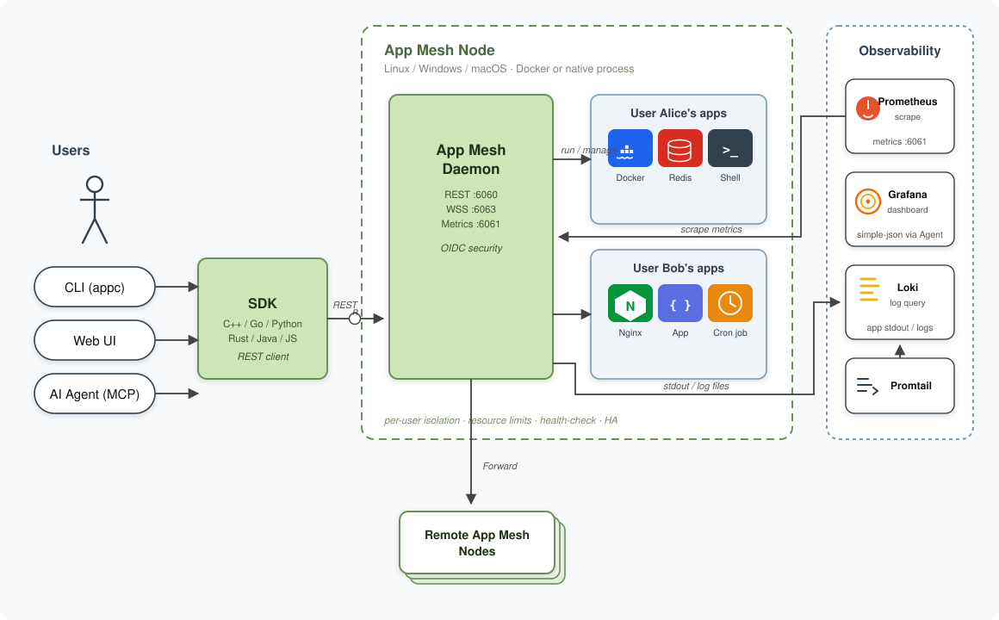
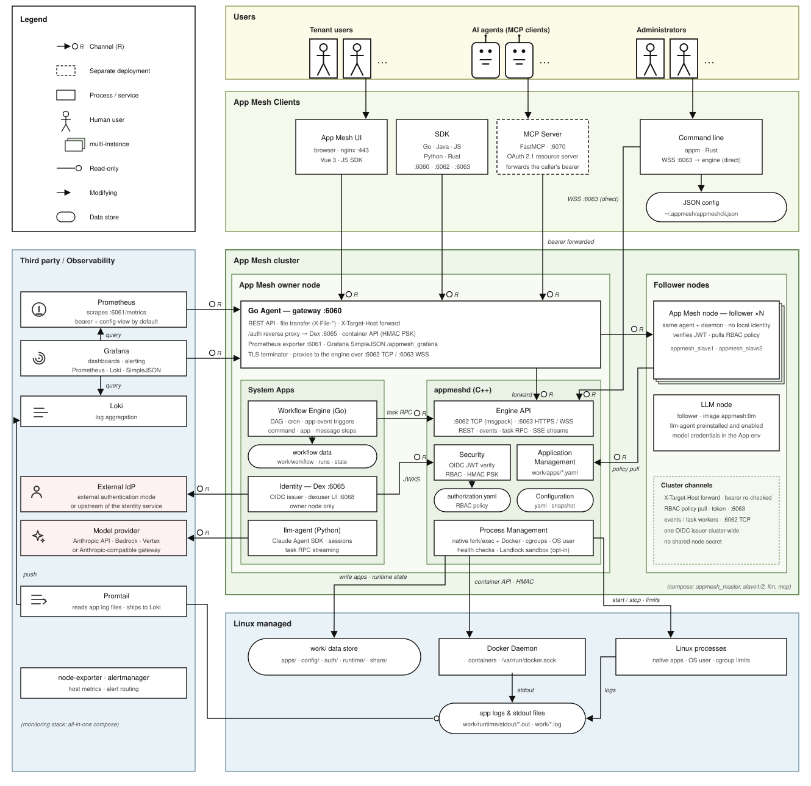

[![language.badge]][language.url] [![standard.badge]][standard.url] [![unittest.badge]][unittest.url] [](https://scan.coverity.com/projects/laoshanxi-app-mesh) [](https://api.securityscorecards.dev/projects/github.com/laoshanxi/app-mesh) [](https://www.bestpractices.dev/projects/12481) [](https://app-mesh.readthedocs.io/en/latest/?badge=latest)

[![release.badge]][release.url] [![docker.badge]][docker.url] [![pypi.badge]][pypi.url] [![npm.badge]][npm.url] [![cargo.badge]][cargo.url] [![cockpit.badge]][cockpit.url] [](https://gitter.im/app-mesh/community?utm_source=badge&utm_medium=badge&utm_campaign=pr-badge&utm_content=badge)

# App Mesh

**One secure, lightweight daemon to run, schedule, and remote-control apps across machines.**

## 🧭 Concepts

App Mesh gives you two capabilities: **Hosting** and **Computing**.

### 🎛 Hosting

Declare an app once. The daemon keeps it running.

- **Lifecycle** — start, stop, and recover the app after a crash or a daemon restart
- **Scheduling** — cron, fixed intervals, start and end dates, daily time windows
- **Protection** — health checks, CPU and memory limits, OS user, file system sandbox, tenant isolation
- **Any app** — a native process or a Docker app

Think systemd on every machine. Or Kubernetes desired state, for any app.

### 🧮 Computing

Submit work to any node. Get the result back.

- **Command or script** — starts a new process, runs once
- **Task message** — reuses a warm app that is already running, no startup cost
- **Parallel and control** — fan out work across nodes; run sync or async, stream output, set timeouts
- **Workflow** — chain many work items into a DAG pipeline and run it natively
- **AI** — send task messages to a hosted LLM agent, or give coding agents a sandbox node to build and run

Think serverless, on your own machines.

<div align=center></div>

<details>
<summary>Internal component view</summary>



</details>

## ⚡ Quick Start

Start the daemon in Docker:

```shell
docker run -d --restart=always --name=appmesh --net=host -v appmesh-work:/opt/appmesh/work -v /var/run/docker.sock:/var/run/docker.sock laoshanxi/appmesh:latest
```

The `appmesh-work` volume persists authentication state and application definitions. The container runs as UID 482 — grant that identity access to the Docker socket to manage Docker apps.

Host your first app with the `appm` CLI — open a shell in the daemon container:

```shell
$ docker exec -ti appmesh bash

# Sign in once (non-interactive)
$ /opt/appmesh/script/appmesh-auth.sh print-initial-password | appm logon -u admin@appmesh.local --password-stdin

# List registered applications
$ appm ls
ID  NAME      OWNER   ENABLED  HEALTH  PID  USER     MEMORY  %CPU  RETURN
0   py-task   system  Yes      OK      574  appmesh  32.5Mi  0     -
1   py-exec   system  -        -       -    -        -       -     -
2   identity  system  Yes      OK      344  appmesh  40.5Mi  0     -

# Register a new application
$ appm add -a myapp -c "python3 -u -c 'import time; [print(i, time.ctime()) or time.sleep(1) for i in range(10)]'"

# View its live output
$ appm ls -a myapp -o
0 Wed Sep 16 10:56:12 2026
1 Wed Sep 16 10:56:13 2026
2 Wed Sep 16 10:56:14 2026
```

Send a task message to a running app through the SDK. Mint an admin token first (see the [authentication guide](https://app-mesh.readthedocs.io/en/latest/security/Authentication.html)):

```shell
$ export APPMESH_BEARER_TOKEN=$(/opt/appmesh/script/appmesh-auth.sh print-initial-password \
    | /opt/appmesh/script/appmesh-auth.sh user-token)
```

```python
import os
from appmesh import AppMeshClient
client = AppMeshClient(bearer_token=os.environ["APPMESH_BEARER_TOKEN"])

result_from_server = "0"
for i in range(10):
    task_data = f"print({result_from_server} + {i}, end='')"
    result_from_server = client.run_task(app_name="py-task", data=task_data)
    print(result_from_server)
```

For native packages (`.deb`/`.rpm`), systemd setup, and cluster initialization, see the [Installation Guide](https://app-mesh.readthedocs.io/en/latest/deploy/Install.html) and the [Dockerfile](Dockerfile).

## 🚀 Capabilities

| Pillar    | Capability            | What you get                                                                                                                                            |
| --------- | --------------------- | ------------------------------------------------------------------------------------------------------------------------------------------------------- |
| Hosting   | Application management | Full remote CRUD and control — cgroup limits, OS user, environment variables, Docker apps, stdin/stdout — with start counts, exit codes, and [health checks](https://app-mesh.readthedocs.io/en/latest/engine/AppManagement.html) |
| Hosting   | Scheduling            | Periodic jobs, cron expressions, start/end dates, daily time windows, and policy-driven [exit behaviors](https://app-mesh.readthedocs.io/en/latest/engine/AppManagement.html#exit-behavior) |
| Computing | Remote execution      | Run commands and scripts on any node; send [in-memory task messages](https://app-mesh.readthedocs.io/en/latest/engine/TaskRun.html) to running applications for high-performance computing |
| Computing | Workflow engine       | GitHub-Actions-style [YAML pipelines](https://app-mesh.readthedocs.io/en/latest/engine/workflow/Workflow.html) with DAG scheduling, running natively on App Mesh |
| Platform  | Security              | OAuth/OIDC bearer authentication (RFC 6750) with Principal-based [RBAC and multi-tenant isolation](https://app-mesh.readthedocs.io/en/latest/security/Security.html); [file system sandbox](https://app-mesh.readthedocs.io/en/latest/engine/Sandbox.html); TLS everywhere; HMAC-PSK internal verification |
| Platform  | Observability         | Built-in [Prometheus exporter](https://app-mesh.readthedocs.io/en/latest/observability/Prometheus.html), [Grafana datasource](https://app-mesh.readthedocs.io/en/latest/observability/Grafana.html), [Loki](https://app-mesh.readthedocs.io/en/latest/observability/Loki.html) integration, host/app resource metrics |
| Platform  | AI & LLM              | Managed [agent runtime](https://app-mesh.readthedocs.io/en/latest/engine/LLM.html), streaming chat, workflow message steps, [MCP server](src/integrations/mcp-server) |
| Platform  | Files & platform extras | [File upload/download API](https://app-mesh.readthedocs.io/en/latest/engine/Files.html) with attribute preservation, remote shell execution, hot config reload, bash completion |

Runs on Linux, macOS, and Windows (x86 and ARM).

A workflow in three commands:

```bash
appm workflow add -f pipeline.yaml        # register
appm workflow run pipeline -e env=prod -f # run and follow output
appm workflow runs pipeline               # view history
```

## 🤖 AI & LLM Integration

Agents are just managed Apps: the same RBAC, scheduling, encrypted secrets, health checks, and cluster forwarding as any other process — no sidecar, no privileged pod. Host the bundled [llm-agent runtime](src/apps/llm-agent) (Claude via Anthropic API, Bedrock, or Vertex; DeepSeek, Qwen, GLM, MiniMax, or any OpenAI-compatible model behind a gateway), drive it interactively or from a workflow `message` step, and reach the whole platform from AI clients.

- [AI and LLM scenarios](https://app-mesh.readthedocs.io/en/latest/engine/LLM.html) — interactive chat, scheduled agent jobs, multi-model pipelines
- [Remote sandbox for AI coding assistants](https://app-mesh.readthedocs.io/en/latest/engine/RemoteSandbox.html) — an isolated build-and-run node instead of your local shell
- [MCP server](src/integrations/mcp-server) — manage App Mesh from Claude Code, Codex, and other MCP clients (Streamable HTTP, OAuth 2.1)
- [Remote-execution skill](.agents/skills/appmesh-remote) for coding agents, [MCP bridge](src/integrations/mcp-bridge), and [MQTT bridge](src/integrations/mqtt)

## 🧰 Interfaces & SDKs

| Interface | Details                                                                                                                                                                  |
| --------- | ------------------------------------------------------------------------------------------------------------------------------------------------------------------------ |
| CLI       | [`appm` command reference](https://app-mesh.readthedocs.io/en/latest/interfaces/CLI.html)                                                                                           |
| REST      | [REST APIs](https://app-mesh.readthedocs.io/en/latest/interfaces/RESTAPI.html) · [OpenAPI spec](https://petstore.swagger.io/?url=https://raw.githubusercontent.com/laoshanxi/app-mesh/main/src/daemon/rest/openapi.yaml) |
| Web GUI   | [app-mesh-ui](https://github.com/laoshanxi/app-mesh-ui)                                                                                                                            |
| SDKs      | [Python](https://app-mesh.readthedocs.io/en/latest/interfaces/api/appmesh.html#module-appmesh.client_http) · [Golang](src/sdk/go/README.md) · [Rust](src/sdk/rust) · [Java](src/sdk/java/README.md) · [JavaScript](https://www.npmjs.com/package/appmesh) |

## 🆚 Comparison

| Feature                       | App Mesh     | [Nomad](https://www.nomadproject.io/) | [Rundeck](https://www.rundeck.com/open-source) | [Kubernetes](https://kubernetes.io/) | [systemd](https://systemd.io/) |
| ----------------------------- | ------------ | ------------------------------------- | ---------------------------------------------- | ------------------------------------ | ------------------------------ |
| Control plane                 | None         | 3–5 servers                           | 1 (HA: Enterprise)                             | 3+ nodes                             | None                           |
| Native (non-container) app    | √            | √                                     |                                                |                                      | √                              |
| Docker app                    | √            | √                                     |                                                | √                                    |                                |
| Cron schedule                 | √            | √                                     | √                                              | CronJob                              | Timers                         |
| Remote command or script      | √            | √                                     | √ SSH                                          | √                                    |                                |
| Task message to a running app | √            |                                       |                                                |                                      |                                |
| Workflow                      | DAG          |                                       | Steps                                          | Add-on                               |                                |
| LLM agent runtime, MCP server | √            |                                       |                                                |                                      |                                |
| Auth and per-tenant RBAC      | OIDC         | OIDC                                  | ACL                                            | OIDC, RBAC                           |                                |
| SDK                           | 5 languages  | Go                                    |                                                | Official                             |                                |

## 📚 Documentation

- [Read the Docs](https://app-mesh.readthedocs.io/) — full documentation
- [Feature Overview](docs/source/FeatureOverview.md) — the full capability map behind Hosting and Computing, including the AI and LLM group
- [Installation Guide](https://app-mesh.readthedocs.io/en/latest/deploy/Install.html) · [Security](https://app-mesh.readthedocs.io/en/latest/security/Security.html) · [Application Sandbox](https://app-mesh.readthedocs.io/en/latest/engine/Sandbox.html) · [Workflow Guide](https://app-mesh.readthedocs.io/en/latest/engine/workflow/Workflow.html)
- [Success stories](https://app-mesh.readthedocs.io/en/latest/success/remote_run_cli_and_python.html) — worked recipes: remote execution, monitoring stack, Kubernetes, file serving, and more

## Community & License

Questions and discussions are welcome on [Gitter](https://gitter.im/app-mesh/community). Licensed under the [MIT License](LICENSE).

[language.url]: https://isocpp.org/
[language.badge]: https://img.shields.io/badge/language-C%2B%2B-blue.svg
[standard.url]: https://en.wikipedia.org/wiki/C%2B%2B#Standardization
[standard.badge]: https://img.shields.io/badge/C%2B%2B-11%2F14%2F17%2F20-blue.svg
[release.url]: https://github.com/laoshanxi/app-mesh/releases
[release.badge]: https://img.shields.io/github/v/release/laoshanxi/app-mesh?label=Github%20package
[docker.url]: https://hub.docker.com/repository/docker/laoshanxi/appmesh
[docker.badge]: https://img.shields.io/docker/pulls/laoshanxi/appmesh.svg
[cockpit.url]: https://github.com/laoshanxi/app-mesh-ui
[cockpit.badge]: https://img.shields.io/badge/Web%20GUI-app--mesh--ui-blue
[unittest.url]: https://github.com/catchorg/Catch2
[unittest.badge]: https://img.shields.io/badge/UnitTest-Catch2-blue?logo=appveyor
[pypi.badge]: https://img.shields.io/pypi/v/appmesh?label=PyPI%3Aappmesh
[pypi.url]: https://pypi.org/project/appmesh/
[npm.badge]: https://img.shields.io/npm/v/appmesh?label=npm%3Aappmesh
[npm.url]: https://www.npmjs.com/package/appmesh
[cargo.badge]: https://img.shields.io/crates/v/appmesh
[cargo.url]: https://crates.io/crates/appmesh
